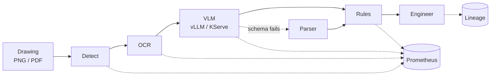

# From Prototype to Service
### Integrating, evaluating and preparing AI components for engineering workflows

**lyftium**1

1 Aerospace engineering background · Data science (Liora × Mines Paris – PSL) · LYFTIUM Labs, Paris · French / English

 

 

 

[**1 · Framing**](#1-framing) ·
[**2 · Drawing review**](#2-drawing-review-service--integration-and-evaluation) ·
[**3 · Fine-tuning**](#3-lora-finetune-recipe--adaptation-and-evaluation) ·
[**4 · Inference**](#4-vllm-serving-benchmark--throughput-and-latency) ·
[**5 · Supporting**](#5-supporting-work) ·
[**6 · Limits**](#6-scope-and-limits) ·
[**Kaggle**](https://www.kaggle.com/lyftium)

---

> **Abstract.** Applied machine learning for engineering stalls less often on model accuracy than on the gap between a notebook and a component that another engineer can call, score and prepare for deployment. This note collects public work on that gap. The primary evidence is three artefacts, in order of relevance to integration work: (i) a document-review microservice with an API, evaluation gates and container / Kubernetes / OpenShift AI manifests; (ii) a LoRA fine-tuning recipe that measures a baseline before training and records lineage for every run; (iii) a GPU serving study of vLLM under batching, quantisation, tensor parallelism and load. Supporting repositories cover an AI gateway with a tool-calling agent, and off-policy evaluation of decision policies from logged data. Every project below states what was measured, how to reproduce it, and what has not been run on a live cluster.
>
> **Keywords:** AI integration · model evaluation · LLM / VLM serving · parameter-efficient fine-tuning · MLOps preparation · traceability · engineering workflows

---

## 1. Framing

I work at the intersection of **aerospace engineering practice** (design, technical drawings, validation) and **AI integration**: turning machine-learning capabilities into practical, testable components for engineering workflows. My public work focuses on document intelligence, model evaluation, reproducible Python pipelines and API-based integration, and explores LLM fine-tuning, inference performance and deployment preparation.

Four habits recur across the repositories:

1. **Contracts first** — typed request / response schemas, structured errors, health and readiness that mean different things.
2. **Baselines before adapters** — fine-tuning is scored against the untouched model on the same held-out set.
3. **Lineage by default** — git commit, config hash, data hash and library versions sit next to every result.
4. **Humans where errors are expensive** — automated checks narrow the work; an engineer signs off.

Optinampout ([optinampout.com](https://www.optinampout.com)) is a secondary activity on applying agentic AI to operational workflows, with attention to integration and security constraints. No client outcomes are claimed here.

---

## 2. Drawing Review Service — integration and evaluation

**[drawing-review-service](https://github.com/lyftium/drawing-review-service)** is a *public demonstrator* of an engineering-document review pipeline (detection → OCR → vision–language model → rule checks → human review). It is distinct from the private prototype described in §5.1.

<b>Figure 1.</b> Request path. Backends are plug-ins; CPU stubs let tests run without weights.

| | |
|:--|:--|
| **Problem** | A drawing-analysis prototype that only runs locally cannot be shared, scored or prepared for cluster deployment. |
| **Architecture** | FastAPI service; pluggable backends (CPU stubs + OpenAI-compatible VLM client); golden-set evaluation; Docker image; Kubernetes and OpenShift AI / KServe manifests (RawDeployment, vLLM ServingRuntime). |
| **Verify** | `make install && make test` (57 CPU tests) · `make eval` · `make validate` (kustomize + kubeconform) · `make image && docker run --rm -p 8080:8080 --read-only --tmpfs /tmp drawing-review:dev` |
| **Results** | Service contracts, evaluation gates and schema-validated manifests are in the repository; see Table 1. |
| **Status & limits** | OpenShift AI and KServe manifests are prepared and schema-validated; **not applied to a live GPU cluster**. CI workflow is written (`ci/github-actions-ci.yml`) but **not enabled**. No green CI badge is shown. |
| **Next** | Apply the OpenShift AI overlay on a shared GPU project; enable CI once a token with `workflow` scope is available. |

<b>Table 1.</b> What is implemented in the public demonstrator.

| Concern | Implementation |
|:--|:--|
| Interface | FastAPI, pydantic schemas, 413 / 415 / 422 / 503 with request id |
| Inference client | Streaming OpenAI-compatible client, TTFT metric, schema validation with fallback |
| Model serving manifests | KServe `ServingRuntime` + `InferenceService` (RawDeployment), CRD-schema validated |
| Packaging | Multi-stage non-root image, read-only root filesystem |
| Platform | Restricted Pod Security, NetworkPolicy, OpenShift Route / SCC-compatible overlay |
| Evaluation | Golden set, release gates, extraction vs. business metrics |
| Traceability | Per-run lineage; engineering checklist mapped to the EU AI Act (*not a legal claim*) |
| Tests | 57 unit and integration tests, CPU only |

---

## 3. LoRA Fine-Tune Recipe — adaptation and evaluation

**[lora-finetune-recipe](https://github.com/lyftium/lora-finetune-recipe)** is a small-scale experiment in model adaptation: evaluate the base model → train a LoRA / QLoRA adapter → evaluate on the **same** held-out set → write a report and a run record. The task maps drawing annotations to structured JSON.

| | |
|:--|:--|
| **Problem** | Fine-tuning is often reported without a baseline on the same split, so the adapter's contribution is unclear. |
| **Architecture** | Single CLI loop; PEFT LoRA / QLoRA; answer-token loss only; lineage (git sha, config hash, data hash, dirty flag); optional `torchrun` DDP. |
| **Verify** | `pip install -e . && pytest` (14 CPU tests) · `python -m lora_recipe.cli run --config configs/tiny-cpu.yaml` · results under `results/qwen-0.5b-lora/` |
| **Results** | Table 2. Companion GPU notebook: [LoRA Fine-Tuning: Baseline vs Adapter](https://www.kaggle.com/code/lyftium/lora-fine-tuning-baseline-vs-adapter). |
| **Status & limits** | The reported baseline is an **unprompted** base model (never shown the target schema). A prompted / few-shot baseline on the same split is **not done**. The `tiny-ddp` run proves **two-process DDP mechanics** on a tiny model (CPU gloo); it is **not** a multi-GPU training result. CUDA NCCL path is wired, not demonstrated here. |
| **Next** | Prompted baseline; a real multi-GPU DDP run with the same lineage record. |

<b>Table 2.</b> Qwen2.5-0.5B on the held-out set (<code>results/qwen-0.5b-lora/</code>). Adapter vs unprompted base.

| | Base (unprompted) | + LoRA |
|:--|:--:|:--:|
| Valid JSON | 0.66 | **1.00** |
| Exact match | 0.00 | **0.97** |
| Trainable parameters | — | 2.16 M / 496 M (0.44 %) |
| Wall time | — | 559 s |

---

## 4. vLLM Serving Benchmark — throughput and latency

**[vLLM Serving Benchmark on T4](https://www.kaggle.com/code/lyftium/vllm-serving-benchmark-t4)** measures how serving levers move throughput and latency on commodity GPUs (2× Tesla T4, compute 7.5, fp16).

| | |
|:--|:--|
| **Problem** | Manifests and metrics alone do not show which serving settings actually matter under load. |
| **Setup** | vLLM 0.6.6.post1 (V0 engine) in an isolated Python 3.12 environment; Qwen2.5 0.5B / 1.5B (fp16 and AWQ); continuous batching, online streaming, quantisation, tensor parallel, prefix caching. |
| **Verify** | Public notebook + committed `results.json` on the Kaggle output; every figure below is copied from that file. |
| **Results** | Table 3. |
| **Status & limits** | **Exploratory: one run per configuration**, not repeated trials. Workload never exhausted the KV cache, so a `gpu_memory_utilization` sweep was skipped. This is a **GPU measurement**, not a cluster deployment. |
| **Next** | Repeat key cells with error bars; run the same protocol against a KServe InferenceService on a real cluster. |

<b>Table 3.</b> Serving levers on Tesla T4 (single runs; from <code>results.json</code>).

| Lever | Measurement | Result |
|:--|:--|:--|
| Continuous batching | 0.5B fp16, gen. tok/s, `max_num_seqs` 1 → 128 | 145 → 5 126 (**35×**) |
| Online streaming | 0.5B fp16, concurrency 1 → 32 | 141 → 2 536 tok/s; TTFT p50 39 → 148 ms; 0 errors |
| AWQ vs fp16 (1.5B) | tok/s at 1 / 128 sequences | **1.61×** faster / **0.50×** slower; weights 2.89 → 1.10 GiB |
| AWQ quality | exact match on 50 checks (0.5B / 1.5B) | 0.92 → 0.72 / 0.98 → 0.94 |
| Tensor parallel 2 vs 1 | 0.5B, 128 sequences | **0.86×** (slower at this size over PCIe) |
| Prefix caching | shared ~1k-token system prompt | 14.3 → 23.0 req/s (**1.61×**) |

Reading: on this hardware, **batching** dominates; AWQ helps single-stream latency and memory but costs throughput under load and accuracy on the small model; tensor parallelism is for models that do not fit on one GPU, not for speed here.

---

## 5. Supporting work

### 5.1 Private engineering prototype *(not a public result)*

A local prototype of the drawing-review stack (YOLO, OCR, LoRA-tuned LLaVA, LangGraph orchestration) reported **74 % mAP@50** and **69.2 % F1** on **38** held-out drawings. Those figures belong to that private run; they are **not** customer or programme results. §2 is the public, model-free rebuild of the service shape.

### 5.2 AI gateway and tool-calling agent

**[agent-gateway-stack](https://github.com/lyftium/agent-gateway-stack)** — OpenAI-compatible gateway (auth by key hash, per-tenant quotas, failover, streaming pass-through, no prompt logging) and a bounded tool-calling agent (typed tools, timeouts, human approval for side effects). Gateway overhead ≈ **1.5 ms** p50 at concurrency 1 against an instant mock (median of 3 × 1 500 requests, laptop). OpenShift AI / KServe manifests prepared; **not applied live**. 46 tests; CI written, not enabled.

### 5.3 Off-policy evaluation

**[off-policy-bandit-evaluation](https://github.com/lyftium/off-policy-bandit-evaluation)** — can a new policy be scored from another policy's logs before a live test? On the Open Bandit Dataset[^1], estimators on 1.37 M logged rounds recover the production CTR within **5.3–6.1 %** relative error (IPW / SNIPW / DR intervals cover the truth; DM's does not). Related notebook: [YOLO Road Damage: Honest Evaluation](https://www.kaggle.com/code/lyftium/yolo-road-damage-honest-evaluation).

### 5.4 Other unpublished work

PLM access for agents via an MCP server; Kafka → ClickHouse streaming and pre-trade simulation at LYFTIUM Labs. Walkthroughs on request.

---

## 6. Scope and limits

| Claim one might infer | What is actually shown |
|:--|:--|
| “OpenShift / KServe deployment” | Manifests exist and validate against schemas; **no live cluster apply** is documented |
| “Multi-GPU distributed training” | Two-process DDP **mechanics** on a tiny model; **no multi-GPU convergence study** |
| “Production CI” | Workflows are written; **not enabled** on the public repositories |
| “Serving numbers” | vLLM study is **single-run** exploratory on Kaggle T4s |
| “Private prototype metrics” | Personal local run on 38 drawings; **not attributed to any employer or customer** |

---

## 7. Toolkit

| Layer | Tools |
|:--|:--|
| Languages | Python · Bash · SQL |
| Models | PyTorch · Hugging Face Transformers · PEFT (LoRA / QLoRA) · Ultralytics YOLO · OpenCV |
| Inference | vLLM (OpenAI-compatible API, tool calling) · KServe · FastAPI |
| Integration | AI gateway · per-tenant quotas · bounded tool loop · human approval |
| Training | `torchrun` / DDP · bitsandbytes 4-bit · Kaggle GPUs |
| Platform | Docker · Kubernetes · OpenShift / OpenShift AI · Kustomize · Prometheus |
| Data | Kafka · ClickHouse · pandas · NumPy |

---

## References

1. lyftium. *drawing-review-service*. https://github.com/lyftium/drawing-review-service
2. lyftium. *lora-finetune-recipe*. https://github.com/lyftium/lora-finetune-recipe
3. lyftium. *vLLM Serving Benchmark on T4*. https://www.kaggle.com/code/lyftium/vllm-serving-benchmark-t4
4. lyftium. *agent-gateway-stack*. https://github.com/lyftium/agent-gateway-stack
5. lyftium. *off-policy-bandit-evaluation*. https://github.com/lyftium/off-policy-bandit-evaluation
6. Saito et al., *Open Bandit Dataset and Pipeline*, NeurIPS Datasets and Benchmarks, 2021.

[^1]: Open Bandit Dataset; see reference 6.

---

Aerospace engineering · Data science (Liora × Mines Paris – PSL) · LYFTIUM Labs, Paris 
<a href="mailto:contact@lyftium.com">contact@lyftium.com</a> ·
<a href="https://www.optinampout.com">optinampout.com</a> ·
<a href="https://www.kaggle.com/lyftium">kaggle.com/lyftium</a> ·
<a href="https://github.com/lyftium">github.com/lyftium</a>

