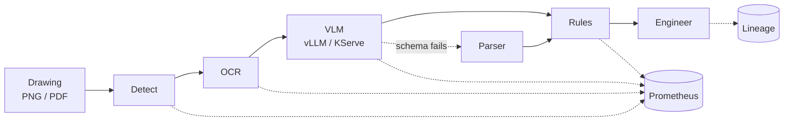

# AI Integration for Engineering Systems
### Evaluating decisions and models · serving them · packaging them so other engineers can run them

**Pierre**1 — Data Scientist · AI Integration & Engineering

1 Aerospace engineering · Data science, Liora × Mines Paris – PSL · French / English

 

[**1 · Framing**](#1-framing) ·
[**2 · Decision evaluation**](#2-off-policy-evaluation--decisions-from-logged-data) ·
[**3 · Drawing review**](#3-drawing-review-service--from-prototype-to-testable-microservice) ·
[**4 · Fine-tuning**](#4-lora-finetune-recipe--baseline-first-lineage-kept) ·
[**5 · Inference**](#5-vllm-serving-benchmark--throughput-and-latency) ·
[**6 · Gateway**](#6-ai-gateway--tool-calling-agent) ·
[**7 · Supporting**](#7-supporting-work) ·
[**8 · Limits**](#8-scope-and-limits) ·
[**Kaggle**](https://www.kaggle.com/lyftium)

---

| 30-second glance | Start here | Proof ceiling |
|:--|:--|:--|
| **Data scientist** | [off-policy-bandit-evaluation](https://github.com/lyftium/off-policy-bandit-evaluation) · [`DEMO`](https://github.com/lyftium/off-policy-bandit-evaluation/blob/main/docs/DEMO.md) | 1.37 M logs · bootstrap CIs · time split · estimated lift ≠ A/B |
| **AI integrator** | [drawing-review-service](https://github.com/lyftium/drawing-review-service) · [`DEMO`](https://github.com/lyftium/drawing-review-service/blob/main/docs/DEMO.md) | Live CI · Kind Ready · GHCR · OpenShift AI **not** live |
| **LLM serving + gateway** | [vLLM T4](https://github.com/lyftium/vllm-serving-benchmark-t4) · [agent-gateway-stack](https://github.com/lyftium/agent-gateway-stack) · DRS KServe | Measured levers (single-run) · Kind gateway+mock · manifests **not** live GPU |
| **Also** | LoRA · [Kaggle](https://www.kaggle.com/lyftium) | Each flagship has `docs/DEMO.md` |

> **Abstract.** Two hiring lenses, one public body of work. As a **data scientist**, the core habit is honest evaluation before a decision: baselines on the same split, uncertainty (bootstrap CIs), chronological hold-outs, and refusing a precise-but-wrong estimator. As an **AI integrator**, the same habit continues into packaging: typed APIs, gates, images, Kind-proven Kubernetes prep. Primary DS evidence: off-policy evaluation on **1.37 M** real bandit rounds. Primary integration evidence: drawing-review microservice, LoRA recipe with prompted baseline, vLLM T4 protocol study, AI gateway + approve-once agent. Every project states what was measured, how to reproduce it, and what was not run live.
>
> **Keywords:** data science · off-policy evaluation · baselines · confidence intervals · model evaluation · AI integration · LLM / VLM serving · AI gateway · LoRA · MLOps preparation · traceability · engineering workflows
>
> **FR (signaux):** data scientist · évaluation hors-politique / intervalles de confiance · baselines · aide à la décision · intégration de composants IA · non-régression · serving vLLM · fine-tuning LoRA · préparation OpenShift AI / KServe · traçabilité · supervision humaine — preuves en anglais; pas de cluster OpenShift live.

---

Tooling reflected in the public artefacts (OpenShift AI = manifests prepared, not a live-cluster claim)

 

 

## 1. Framing

I work as a **data scientist** with an **integration** bias: aerospace engineering practice (drawings, validation) meets evaluation-first ML — then packaging so another engineer can call, score and prepare a component. Public work spans off-policy decision evaluation, document intelligence, fine-tuning with honest baselines, inference measurement, and gateway/agent controls.

Five habits recur:

1. **Question before model** — state the decision (ship a policy? promote an adapter?) and the counterfactual.
2. **Baselines and uncertainty** — same-split baselines; bootstrap CIs; chronological hold-outs; call out over-confident estimators.
3. **Contracts first** — typed APIs, structured errors, health ≠ readiness.
4. **Lineage by default** — git, config/data hashes and library versions next to every result.
5. **Humans where errors are expensive** — gates narrow the work; an engineer signs off.

### Screener pitches (≈90 s)

**Data scientist track.** Start at [off-policy-bandit-evaluation](https://github.com/lyftium/off-policy-bandit-evaluation) ([`DEMO`](https://github.com/lyftium/off-policy-bandit-evaluation/blob/main/docs/DEMO.md)): recover production CTR from 1.37 M logged rounds within 5.3–6.1 % relative error; IPW/SNIPW/DR CIs cover truth, DM’s does not; popularity beats a weak GBDT-greedy on a time split (~2.1× estimated lift — candidate for A/B, not a shipped result). Then [lora-finetune-recipe](https://github.com/lyftium/lora-finetune-recipe) (unprompted exact_match 0.0 → fewshot 0.8 on the same `test_data_hash`) and [YOLO Road Damage: Honest Evaluation](https://www.kaggle.com/code/lyftium/yolo-road-damage-honest-evaluation).

**Integrator track.** Start at [drawing-review-service](https://github.com/lyftium/drawing-review-service) ([`DEMO`](https://github.com/lyftium/drawing-review-service/blob/main/docs/DEMO.md)) → measure levers on [vLLM T4](https://github.com/lyftium/vllm-serving-benchmark-t4) → put [agent-gateway-stack](https://github.com/lyftium/agent-gateway-stack) in front (authz / quotas / failover / approve-once) → DRS/AGS KServe manifests for cluster prep. Then LoRA. Limits: Kind Ready ≠ live GPU OpenShift; DDP lab ≠ multi-node NCCL; single-run serving ≠ SLO.

**FR (90 s):** Data scientist — évaluation hors-politique, IC bootstrap, baselines, aide à la décision avant A/B. Intégrateur — contrats/API/tests/image, serving mesuré, gateway + approve-once. Preuves en anglais; OpenShift AI préparé, pas live.

## 1.1 Integration competence map (public artefacts only)

How an **integrator** screener maps skills to repositories — without inventing cluster claims:

| Skill signal | Where to look | Evidence level |
|:--|:--|:--|
| Package → API → tests → image → CI | [drawing-review-service](https://github.com/lyftium/drawing-review-service) · [`DEMO`](https://github.com/lyftium/drawing-review-service/blob/main/docs/DEMO.md) | Live CI + Kind Ready |
| Release identity (commit ↔ image digest ↔ eval) | [`docs/image-digests.md`](https://github.com/lyftium/drawing-review-service/blob/main/docs/image-digests.md), `releases/` | GHCR `RepoDigests` recorded |
| K8s / OpenShift prep (SCC, NetworkPolicy, probes, rollback) | `deploy/` + [`docs/runbook.md`](https://github.com/lyftium/drawing-review-service/blob/main/docs/runbook.md) + Kind rollback transcript | Schema-validated; Kind Ready + undo; GPU OpenShift not live |
| Inference levers (batching, AWQ, TP, TTFT) | [vllm-serving-benchmark-t4](https://github.com/lyftium/vllm-serving-benchmark-t4) · [`DEMO`](https://github.com/lyftium/vllm-serving-benchmark-t4/blob/main/docs/DEMO.md) | Single Kaggle campaign + `PROTOCOL.md` |
| Fine-tune + lineage + resume | [lora-finetune-recipe](https://github.com/lyftium/lora-finetune-recipe) · [`DEMO`](https://github.com/lyftium/lora-finetune-recipe/blob/main/docs/DEMO.md) | CPU tests + prompted baseline artefact |
| DDP token-weighted loss (math, not NCCL) | LoRA `labs/ddp-token-weighting/` | Deterministic CPU NumPy lab |
| Gateway authz / quotas / agent allowlist | [agent-gateway-stack](https://github.com/lyftium/agent-gateway-stack) · [`DEMO`](https://github.com/lyftium/agent-gateway-stack/blob/main/docs/DEMO.md) | Tests + GHCR + Kind Ready + agent-run (ISA / approve-once) |
| Serving path (one track) | DRS `deploy/kserve/` ↔ [vLLM bench](https://github.com/lyftium/vllm-serving-benchmark-t4) ↔ [AGS](https://github.com/lyftium/agent-gateway-stack) | Manifests · measured levers · edge controls (mock Kind; GPU OpenShift not live) |
| Pending-first diagnosis (events before “add GPUs”) | DRS [`docs/runbook.md`](https://github.com/lyftium/drawing-review-service/blob/main/docs/runbook.md) | Decision tree + Kind rollback transcript |
| Model ingest (no casual `trust_remote_code`) | LoRA [`docs/model-ingest.md`](https://github.com/lyftium/lora-finetune-recipe/blob/main/docs/model-ingest.md) | Policy + pytest |
| Digest ≠ signature ≠ approval | DRS [`checklists/release-approval.md`](https://github.com/lyftium/drawing-review-service/blob/main/checklists/release-approval.md) | Release checklist (engineering, not a legal claim) |
| AI Act–style control map (engineering) | DRS [`docs/ai-act-mapping.md`](https://github.com/lyftium/drawing-review-service/blob/main/docs/ai-act-mapping.md) · AGS [`docs/vnv.md`](https://github.com/lyftium/agent-gateway-stack/blob/main/docs/vnv.md) | Checklist + V&V split; **not** a conformity certificate |
| Off-policy decision evaluation | [off-policy-bandit-evaluation](https://github.com/lyftium/off-policy-bandit-evaluation) · [`DEMO`](https://github.com/lyftium/off-policy-bandit-evaluation/blob/main/docs/DEMO.md) | Real OBD logs; numbers in `results.json` |

## 1.2 Data scientist competence map (public artefacts only)

How a **data scientist** screener maps skills — numbers only from published artefacts:

| Skill signal | Where to look | Evidence level |
|:--|:--|:--|
| Decision from logged data (OPE) | [off-policy-bandit-evaluation](https://github.com/lyftium/off-policy-bandit-evaluation) · [`DEMO`](https://github.com/lyftium/off-policy-bandit-evaluation/blob/main/docs/DEMO.md) | 1.37 M rounds; IPW/SNIPW/DR; `results.json` |
| Estimator honesty (CI covers truth) | OPE E1 table | DM excludes truth; weighted estimators cover |
| Chronological train/test (no look-ahead) | OPE E2 | 70/30 time split; ~2.1× estimated lift ≠ A/B |
| EDA under class imbalance | OPE `figures/eda.png` + `results.json`→`eda` | CTR ~0.35%; slot/item ranges |
| Baseline before claiming lift | [lora-finetune-recipe](https://github.com/lyftium/lora-finetune-recipe) prompted modes | exact_match 0.0 → 0.8 fewshot, same hash |
| CV / detection evaluation discipline | [YOLO honest evaluation](https://www.kaggle.com/code/lyftium/yolo-road-damage-honest-evaluation) (Kaggle) | Notebook; not employer metrics |
| Extraction vs business metrics | DRS golden gates | Separated in eval harness |

---

## 2. Off-policy evaluation — decisions from logged data

**[off-policy-bandit-evaluation](https://github.com/lyftium/off-policy-bandit-evaluation)** — can a new policy be scored from another policy's logs before a live test? On the Open Bandit Dataset[^1], estimators on 1.37 M logged rounds recover the production CTR within **5.3–6.1 %** relative error (IPW / SNIPW / DR intervals cover the truth; DM's does not). Screener path: [`DEMO`](https://github.com/lyftium/off-policy-bandit-evaluation/blob/main/docs/DEMO.md). Related notebook: [YOLO Road Damage: Honest Evaluation](https://www.kaggle.com/code/lyftium/yolo-road-damage-honest-evaluation).

| | |
|:--|:--|
| **Problem** | Can we score a new policy from another policy’s logs before an A/B test? |
| **Verify** | [`DEMO`](https://github.com/lyftium/off-policy-bandit-evaluation/blob/main/docs/DEMO.md) · `pytest -q` · numbers = [`results.json`](https://github.com/lyftium/off-policy-bandit-evaluation/blob/main/results.json) |
| **Method** | DM / IPW / SNIPW / DR · 200 bootstrap CIs · GBDT reward model (2-fold cross-fit) · LinUCB replay |
| **Status & limits** | Fashion e-commerce OBD (not aerospace). Estimated lift ≠ observed A/B. Full campaign needs the public zip (~15 min). |

---

## 3. Drawing Review Service — from prototype to testable microservice

**[drawing-review-service](https://github.com/lyftium/drawing-review-service)** is a *public demonstrator* of an engineering-document review pipeline (detection → OCR → vision–language model → rule checks → human review). It is distinct from the private prototype described in §7.1.

<b>Figure 1.</b> Request path. Backends are plug-ins; CPU stubs let tests run without weights.

| | |
|:--|:--|
| **Problem** | A drawing-analysis prototype that only runs locally cannot be shared, scored or prepared for cluster deployment. |
| **Architecture** | FastAPI service; pluggable backends (CPU stubs + OpenAI-compatible VLM client); golden-set evaluation; Docker image; Kubernetes and OpenShift AI / KServe manifests (RawDeployment, vLLM ServingRuntime); model/data cards + risk register. |
| **Verify** | [`DEMO.md`](https://github.com/lyftium/drawing-review-service/blob/main/docs/DEMO.md) · `make test` / `make eval` / `make validate` · Kind Ready + rollback · GHCR digest |
| **Results** | Service contracts, evaluation gates and schema-validated manifests are in the repository; see Table 1. |
| **Status & limits** | Kind apply **Ready 1/1** + eval Job Complete ([evidence](https://github.com/lyftium/drawing-review-service/tree/main/docs/evidence/kind-apply)). OpenShift AI / GPU cluster **not** applied live. CI green on `main`; GHCR digest `sha256:77d1723b9d2a1a565ec8fa61787db5f881bf5a77156cfa7f4744b15c893b9bad` pinned in base/OpenShift overlays ([digests](https://github.com/lyftium/drawing-review-service/blob/main/docs/image-digests.md)). |
| **Next** | Apply `deploy/openshift-ai` on a shared GPU project; measure TTFT against a real InferenceService. |

<b>Table 1.</b> What is implemented in the public demonstrator.

| Concern | Implementation |
|:--|:--|
| Interface | FastAPI, pydantic schemas, 413 / 415 / 422 / 503 with request id |
| Inference client | Streaming OpenAI-compatible client, TTFT metric, schema validation with fallback |
| Model serving manifests | KServe `ServingRuntime` + `InferenceService` (RawDeployment), CRD-schema validated |
| Packaging | Multi-stage non-root image, read-only root filesystem |
| Platform | Restricted Pod Security, NetworkPolicy, OpenShift Route / SCC-compatible overlay |
| Evaluation | Golden set, release gates, extraction vs. business metrics |
| Traceability | Per-run lineage; engineering checklist mapped to the EU AI Act (*not a legal claim*) |
| Tests | 57 unit and integration tests, CPU only |

---

## 4. LoRA Fine-Tune Recipe — baseline first, lineage kept

**[lora-finetune-recipe](https://github.com/lyftium/lora-finetune-recipe)** is a small-scale experiment in model adaptation: evaluate the base model → train a LoRA / QLoRA adapter → evaluate on the **same** held-out set → write a report and a run record. The task maps drawing annotations to structured JSON.

| | |
|:--|:--|
| **Problem** | Fine-tuning is often reported without a baseline on the same split, so the adapter's contribution is unclear. |
| **Architecture** | Single CLI loop; PEFT LoRA / QLoRA; answer-token loss only; lineage (git sha, config hash, data hash, dirty flag); optional `torchrun` DDP. |
| **Verify** | `pip install -e . && pytest` (14 CPU tests) · `python -m lora_recipe.cli run --config configs/tiny-cpu.yaml` · results under `results/qwen-0.5b-lora/` |
| **Results** | Table 2. Companion GPU notebook: [LoRA Fine-Tuning: Baseline vs Adapter](https://www.kaggle.com/code/lyftium/lora-fine-tuning-baseline-vs-adapter). |
| **Status & limits** | Published LoRA table still quotes the **unprompted** base for adapter comparison. Prompted modes on the **same** `test_data_hash`: exact_match unprompted **0.0** → fewshot **0.8** ([artefact](https://github.com/lyftium/lora-finetune-recipe/blob/main/results/prompted-baseline-qwen/eval-base-modes.json)). `tiny-ddp` = two-process **mechanics** (CPU gloo), not multi-GPU quality. |
| **Next** | Prompted vs adapter on GPU; real multi-GPU DDP with the same lineage record. |

<b>Table 2.</b> Qwen2.5-0.5B on the held-out set (<code>results/qwen-0.5b-lora/</code>). Adapter vs unprompted base.

| | Base (unprompted) | + LoRA |
|:--|:--:|:--:|
| Valid JSON | 0.66 | **1.00** |
| Exact match | 0.00 | **0.97** |
| Trainable parameters | — | 2.16 M / 496 M (0.44 %) |
| Wall time | — | 559 s |

---

## 5. vLLM Serving Benchmark — throughput and latency

**[vLLM Serving Benchmark on T4](https://github.com/lyftium/vllm-serving-benchmark-t4)** ([Kaggle notebook](https://www.kaggle.com/code/lyftium/vllm-serving-benchmark-t4)) measures how serving levers move throughput and latency on commodity GPUs (2× Tesla T4, compute 7.5, fp16).

| | |
|:--|:--|
| **Problem** | Manifests and metrics alone do not show which serving settings actually matter under load. |
| **Setup** | vLLM 0.6.6.post1 (V0 engine) in an isolated Python 3.12 environment; Qwen2.5 0.5B / 1.5B (fp16 and AWQ); continuous batching, online streaming, quantisation, tensor parallel, prefix caching. |
| **Verify** | Public notebook + committed `results.json` on the Kaggle output; every figure below is copied from that file. |
| **Results** | Table 3. |
| **Status & limits** | **Exploratory: one run per configuration**, not repeated trials. Workload never exhausted the KV cache, so a `gpu_memory_utilization` sweep was skipped. This is a **GPU measurement**, not a cluster deployment. |
| **Next** | Repeat key cells with error bars; run the same protocol against a KServe InferenceService on a real cluster. |

<b>Table 3.</b> Serving levers on Tesla T4 (single runs; from <code>results.json</code>).

| Lever | Measurement | Result |
|:--|:--|:--|
| Continuous batching | 0.5B fp16, gen. tok/s, `max_num_seqs` 1 → 128 | 145 → 5 126 (**35×**) |
| Online streaming | 0.5B fp16, concurrency 1 → 32 | 141 → 2 536 tok/s; TTFT p50 39 → 148 ms; 0 errors |
| AWQ vs fp16 (1.5B) | tok/s at 1 / 128 sequences | **1.61×** faster / **0.50×** slower; weights 2.89 → 1.10 GiB |
| AWQ quality | exact match on 50 checks (0.5B / 1.5B) | 0.92 → 0.72 / 0.98 → 0.94 |
| Tensor parallel 2 vs 1 | 0.5B, 128 sequences | **0.86×** (slower at this size over PCIe) |
| Prefix caching | shared ~1k-token system prompt | 14.3 → 23.0 req/s (**1.61×**) |

Reading: on this hardware, **batching** dominates; AWQ helps single-stream latency and memory but costs throughput under load and accuracy on the small model; tensor parallelism is for models that do not fit on one GPU, not for speed here.

**Where this sits.** Protocol informs what to ask of a KServe / InferenceService path in DRS (and AGS overlays). The OpenAI-compatible **gateway** in front of a runtime is §6 — Kind-proven against mock-llm, not a live GPU SLO.

---

## 6. AI gateway & tool-calling agent

**[agent-gateway-stack](https://github.com/lyftium/agent-gateway-stack)** — OpenAI-compatible gateway (auth by key hash, per-tenant quotas, failover, streaming pass-through, no prompt logging) and a bounded tool-calling agent (allowlisted tools, typed schemas, timeouts, approve-once for side effects, ISA refuse + injection posture tests). Gateway overhead ≈ **1.5 ms** p50 at concurrency 1 against an instant mock (median of 3 × 1 500 requests, laptop). Kind Ready (mock-llm / gateway / agent) on shared `drw` with live agent-run evidence: ISA completed @ 11 km; `submit_simulation_job` → awaiting_approval → accepted → duplicate ([transcript](https://github.com/lyftium/agent-gateway-stack/blob/main/docs/evidence/kind-apply/agent-run-20261104-190455.txt), [`DEMO`](https://github.com/lyftium/agent-gateway-stack/blob/main/docs/DEMO.md)). OpenShift AI **not** applied live. CI green; GHCR digest `sha256:660b84b00aa62e883af7c5f487b312c7919d69000b1d4ad2f52a1f9ffd3164d8`.

| | |
|:--|:--|
| **Problem** | Clients re-implement keys, quotas, routing and opaque tool loops. |
| **Verify** | [`DEMO`](https://github.com/lyftium/agent-gateway-stack/blob/main/docs/DEMO.md) · pytest (allowlist / approve-once / ISA) · Kind Ready + agent-run transcript · GHCR digest |
| **Serving link** | Gateway is the OpenAI-compatible front door; measured levers live in [vLLM T4](https://github.com/lyftium/vllm-serving-benchmark-t4); KServe `ServingRuntime` / InferenceService overlays are prepared in AGS + DRS (**not** live GPU). |
| **Status & limits** | Kind + **mock-llm** proves plumbing. Quotas are per-replica. OpenShift AI **not** applied live. |

## 7. Supporting work

### 7.1 Private engineering prototype *(not a public result)*

A local prototype of the drawing-review stack (detection, OCR, VLM, orchestration) exists privately and informed the public demonstrator in §3. **No private prototype metrics are published here** — they are not customer or programme results and must not be cited as such. §3 is the shareable, model-free rebuild of the service shape (contracts, gates, packaging).

### 7.2 Other unpublished work

Unpublished explorations (PLM/MCP wiring, event-stream analytics). Available as walkthroughs on request — not public artefacts.

---

**Profile tip — pins (user UI):**
- **Data scientist roles:** [OPE](https://github.com/lyftium/off-policy-bandit-evaluation) → LoRA → DRS → vLLM → AGS (add **OPE** if missing).
- **Integrator / serving roles:** DRS → vLLM → AGS → LoRA → OPE (gateway before LoRA).
Each flagship has a `docs/DEMO.md` screener path. Kaggle: [lyftium](https://www.kaggle.com/lyftium).

## 8. Scope and limits

| Claim one might infer | What is actually shown |
|:--|:--|
| “OpenShift / KServe deployment” | Manifests exist and validate against schemas; **no live cluster apply** is documented |
| “Multi-GPU distributed training” | Two-process DDP **mechanics** on a tiny model; **no multi-GPU convergence study** |
| “Production CI / GHCR” | CI **enabled** on flagships; DRS+AGS digests recorded. Live GPU OpenShift apply still not claimed |
| “Serving numbers” | vLLM study is **single-run** exploratory on Kaggle T4s |
| “Private prototype metrics” | Not published; personal local run only — **not** employer/customer results |
| “Causal / A/B lift shipped” | OPE gives **estimated** lift + CIs on OBD fashion logs — **not** a live A/B or aerospace study |

---

## References

1. lyftium. *drawing-review-service*. https://github.com/lyftium/drawing-review-service
2. lyftium. *lora-finetune-recipe*. https://github.com/lyftium/lora-finetune-recipe
3. lyftium. *vLLM Serving Benchmark on T4*. https://github.com/lyftium/vllm-serving-benchmark-t4 · https://www.kaggle.com/code/lyftium/vllm-serving-benchmark-t4
4. lyftium. *agent-gateway-stack*. https://github.com/lyftium/agent-gateway-stack
5. lyftium. *off-policy-bandit-evaluation*. https://github.com/lyftium/off-policy-bandit-evaluation
6. Saito et al., *Open Bandit Dataset and Pipeline*, NeurIPS Datasets and Benchmarks, 2021.

[^1]: Open Bandit Dataset; see reference 6.

---

Aerospace engineering · Data science (Liora × Mines Paris – PSL) · Paris 
<a href="https://www.kaggle.com/lyftium">kaggle.com/lyftium</a> ·
<a href="https://lyftium.github.io">lyftium.github.io</a> ·
<a href="https://github.com/lyftium">github.com/lyftium</a>

