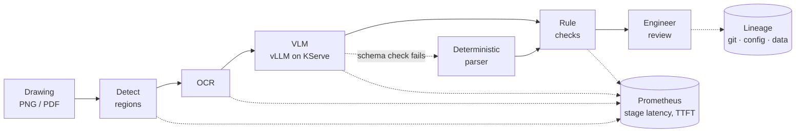

# From Prototype to Service
### Notes on building machine-learning systems that other engineers can run

**lyftium**1

1 · French / English

 

  

 

[**Systems**](#2-serving-a-visionlanguage-pipeline) · [**Training**](#3-fine-tuning-and-distributed-training) · [**Evaluation**](#4-evaluation-before-deployment) · [**Kaggle**](https://www.kaggle.com/lyftium) · [**Contact**](mailto:contact@lyftium.com)

---

> **Abstract.** Much of applied machine learning stalls between a notebook that works and a service that someone else can deploy, monitor and audit. This profile collects public work on that gap. Section 2 describes a vision–language document-review pipeline packaged as a containerised microservice, with GPU inference through vLLM served by KServe, Kubernetes and OpenShift AI manifests, Prometheus metrics and evaluation gates. Section 3 describes a parameter-efficient fine-tuning recipe (LoRA / QLoRA) that measures the base model before training, writes a lineage record for every run, and runs across processes with `torchrun` DDP. Section 4 reports an off-policy evaluation study on 1.37 M real logged decisions. Each project states what was measured, how to reproduce it, and what has not been run yet.
>
> **Keywords:** ML systems · model serving · LLM / VLM inference · distributed training · parameter-efficient fine-tuning · MLOps · evaluation · traceability

---

## 1. Introduction

The working assumption behind everything below is that a model is only useful once it has an interface, an operating envelope and a record of where its outputs came from. In practice that means four habits:

1. **Contracts first** — typed request/response schemas, structured errors, health and readiness that mean different things.
2. **Baselines before adapters** — every fine-tuning run is scored against the untouched model on the same held-out set.
3. **Lineage by default** — git commit, config hash, data hash and library versions are written next to every result.
4. **Humans where errors are expensive** — automated checks narrow the work; an engineer signs off.

I came to this from engineering (design, technical drawings, validation) and a data-science programme with Mines Paris – PSL. At LYFTIUM Labs I build event-driven data and execution infrastructure — Kafka streams into ClickHouse, simulation before execution — for automated trading strategies on public blockchains; that work is not public.

## 2. Serving a vision–language pipeline

**[drawing-review-service](https://github.com/lyftium/drawing-review-service)** turns a technical-drawing analysis prototype into a service: detection → OCR → vision–language model → rule checks → human review.

<b>Figure 1.</b> Request path. Backends are plug-ins; CPU stubs let tests and CI run without weights.

<b>Table 1.</b> What is implemented, and where.

| Concern | Implementation | Location |
|:--|:--|:--|
| Interface | FastAPI, pydantic schemas, 413 / 415 / 422 / 503 errors with request id | `src/drawing_review/api.py` |
| LLM inference | Streaming OpenAI-compatible client to vLLM, time-to-first-token metric, schema validation with fallback | `backends/llava.py` |
| Model serving | KServe vLLM `ServingRuntime` + `InferenceService` (RawDeployment, tensor parallel over 2 GPUs), validated against the KServe CRD schemas | `deploy/kserve/`, `docs/kserve.md` |
| Packaging | Multi-stage, non-root image; read-only root filesystem | `Dockerfile` |
| Orchestration | Restricted Pod Security, probes, PDB, NetworkPolicy, GPU overlay, vLLM with tensor parallelism | `deploy/k8s/` |
| OpenShift / OpenShift AI | Route, SCC-compatible overlay, NetworkPolicies, KServe single-model serving, `PyTorchJob` | `deploy/openshift/`, `deploy/openshift-ai/` |
| Observability | Eight Prometheus metrics and alert rules | `metrics.py`, `deploy/monitoring/` |
| Evaluation | Golden set, release gates, extraction vs. business metrics | `evaluation/` |
| Traceability | Per-run lineage; engineering checklist mapped to the EU AI Act (not a legal claim) | `lineage.py`, `docs/ai-act-mapping.md` |
| Tests | 57 unit and integration tests, CPU only | `tests/` |

**Inference measurements.** The serving levers behind those manifests were measured on GPU in a public notebook, [vLLM Serving Benchmark on T4](https://www.kaggle.com/code/lyftium/vllm-serving-benchmark-t4): vLLM 0.6.6 on two Tesla T4s (no bf16, so fp16), Qwen2.5 0.5B / 1.5B, every figure read from the run's `results.json`, one run per configuration.

<b>Table 2.</b> What each vLLM setting changed on a T4.

| Lever | Measurement | Result |
|:--|:--|:--|
| Continuous batching | 0.5B fp16, generated tokens/s, `max_num_seqs` 1 → 128 | 145 → 5 126 (35×) |
| Online serving | 0.5B fp16 streaming, concurrency 1 → 32 | 141 → 2 536 tok/s; TTFT p50 39 → 148 ms; inter-token p50 6.9 → 11.3 ms; 0 errors |
| AWQ 4-bit vs fp16 | 1.5B, tokens/s at 1 / 128 sequences | 1.61× faster / 0.50× slower; weights 2.89 → 1.10 GiB |
| AWQ quality | exact match on 50 checks (0.5B / 1.5B) | 0.92 → 0.72 / 0.98 → 0.94 |
| Tensor parallel 2 vs 1 | 0.5B, 128 sequences | 0.86× (all-reduce over PCIe costs more than it saves at this size) |
| Prefix caching | ~1k-token shared system prompt, 128 requests | 14.3 → 23.0 req/s (1.61×) |

The practical reading: on this hardware, batching is the lever that matters; AWQ helps single-stream latency and memory but costs throughput under load and accuracy on the small model; tensor parallelism is for models that do not fit on one GPU, not for speed.

## 3. Fine-tuning and distributed training

**[lora-finetune-recipe](https://github.com/lyftium/lora-finetune-recipe)** runs one loop: evaluate the base model → train a LoRA / QLoRA adapter → evaluate on the **same** held-out set → write a report and a run record. The task maps drawing annotations to structured JSON, so scoring is exact.

<b>Table 3.</b> Qwen2.5-0.5B on the held-out set (from <code>results/qwen-0.5b-lora/</code>).

| | Base model | + LoRA adapter |
|:--|:--:|:--:|
| Valid JSON | 0.66 | **1.00** |
| Exact match | 0.00 | **0.97** |
| Trainable parameters | — | 2.16 M / 496 M (0.44 %) |
| Training time | — | 559 s |

The base model never saw the target schema, so Table 3 measures what the adapter adds over an unprompted model; a prompted baseline is the next comparison[^1].

**Distributed path.** The same entry point runs under `torchrun` with `DistributedDataParallel` (gloo on CPU, NCCL on CUDA): one process group, data sharded by rank, gradients all-reduced, rank 0 saves. A two-process run is recorded in `results/tiny-ddp/`; it proves the mechanics on a tiny model, not convergence at scale. A Training Operator `PyTorchJob` for an OpenShift cluster lives in the serving repository.

A GPU companion notebook — base vs. prompted base vs. adapter, two T4 GPUs — is on Kaggle: [LoRA Fine-Tuning: Baseline vs Adapter](https://www.kaggle.com/code/lyftium/lora-fine-tuning-baseline-vs-adapter).

## 4. Evaluation before deployment

**[off-policy-bandit-evaluation](https://github.com/lyftium/off-policy-bandit-evaluation)** asks whether a new decision policy can be evaluated from logs collected by a different one, before any live test. On the Open Bandit Dataset[^2], estimators run on 1.37 M uniformly-random logged rounds are compared with the production policy's true click-through rate, measured on its own 12.4 M rounds.

<b>Table 4.</b> Relative error of the off-policy estimate against on-policy ground truth (from <code>results.json</code>).

| Direct Method | IPW | Self-normalised IPW | Doubly Robust |
|:--:|:--:|:--:|:--:|
| 6.1 % | 5.3 % | 5.3 % | 5.8 % |

The 95 % bootstrap intervals of IPW, SNIPW and DR cover the true value; DM's does not. On a chronological 70 / 30 split, a per-slot popularity policy is estimated at 2.07× the logging policy's CTR.

A related notebook on public data: [YOLO Road Damage: Honest Evaluation](https://www.kaggle.com/code/lyftium/yolo-road-damage-honest-evaluation).

## 5. Work not in public repositories

- **Engineering-drawing review prototype** — YOLO symbol detection, OCR and a LoRA-tuned LLaVA orchestrated by a LangGraph agent, running locally; 74 % mAP@50 and 69.2 % F1 on 38 held-out drawings. Section 2 is its public, model-free rebuild.
- **PLM integration** — an MCP server exposing a product-lifecycle-management system to agents.
- **Streaming data and simulation** — Kafka → ClickHouse pipelines, feature computation and pre-trade simulation at LYFTIUM Labs.

Walkthroughs on request.

## 6. Open items

Stated plainly, because they are the next things to measure: vLLM has been benchmarked on Kaggle GPUs (Table 2, single runs) but the KServe / OpenShift AI path has not been applied to a live cluster; multi-node DDP has not been run on GPUs; CI workflows are written but not yet enabled on these repositories.

## 7. Toolkit

| Layer | Tools |
|:--|:--|
| Languages | Python · Bash · SQL |
| Models | PyTorch · Hugging Face Transformers · PEFT (LoRA / QLoRA) · Ultralytics YOLO · OpenCV |
| Inference | vLLM (OpenAI-compatible API) · KServe · FastAPI |
| Training | `torchrun` / DDP · bitsandbytes 4-bit · Kaggle GPUs |
| Platform | Docker · Kubernetes · OpenShift / OpenShift AI · Kustomize · Prometheus |
| Data | Kafka · ClickHouse · pandas · NumPy |

## References

1. lyftium. *drawing-review-service*. https://github.com/lyftium/drawing-review-service
2. lyftium. *lora-finetune-recipe*. https://github.com/lyftium/lora-finetune-recipe
3. lyftium. *off-policy-bandit-evaluation*. https://github.com/lyftium/off-policy-bandit-evaluation
4. lyftium. Kaggle notebooks. https://www.kaggle.com/lyftium

[^1]: `lora-finetune-recipe` README, “Not done yet”.
[^2]: Saito et al., *Open Bandit Dataset and Pipeline*, NeurIPS Datasets and Benchmarks, 2021.

---

Data Scientist programme, Liora × Mines Paris – PSL · <a href="mailto:contact@lyftium.com">contact@lyftium.com</a> · <a href="https://www.optinampout.com">optinampout.com</a> · <a href="https://www.kaggle.com/lyftium">kaggle.com/lyftium</a>

