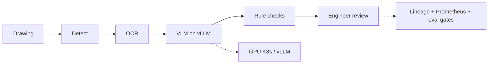

<h1 align="center">lyftium</h1>

  <b>AI component integrator · MLOps · GPU inference</b> 
  Packaging models as services · Kubernetes · vLLM · engineering &amp; simulation AI 
  Île-de-France (Paris / Châteaufort area) · 🇫🇷 French &amp; English

  <picture>
    <source media="(prefers-color-scheme: dark)" srcset="https://readme-typing-svg.demolab.com?font=Fira+Code&weight=500&size=18&pause=1200&color=58A6FF&center=true&vCenter=true&width=620&lines=Industrialize+AI+components+into+microservices;Kubernetes+%2B+vLLM+GPU+serving+%2B+eval+gates;Engineering+drawings+%C2%B7+LoRA+%C2%B7+agentic+pipelines" />
    <source media="(prefers-color-scheme: light)" srcset="https://readme-typing-svg.demolab.com?font=Fira+Code&weight=500&size=18&pause=1200&color=0969DA&center=true&vCenter=true&width=620&lines=Industrialize+AI+components+into+microservices;Kubernetes+%2B+vLLM+GPU+serving+%2B+eval+gates;Engineering+drawings+%C2%B7+LoRA+%C2%B7+agentic+pipelines" />
    
  </picture>

  
  

  

I take AI prototypes (detection, VLMs, LoRA adapters, agents) and turn them into **deployable components**: refactored Python services, Docker images, Kubernetes manifests for GPU nodes, evaluation gates, and run lineage so a result can be traced back to code, model, data and config.

That is the work I want to do next — industrialising AI components on a shared compute cluster for engineering and simulation teams.

## Fit for an AI compute / integrator role

| Need | Evidence |
|---|---|
| **Python + PyTorch / Hugging Face** | [lora-finetune-recipe](https://github.com/lyftium/lora-finetune-recipe) (PEFT LoRA/QLoRA, transformers); CV + VLM stack in drawing review |
| **Package as microservices & deploy** | [drawing-review-service](https://github.com/lyftium/drawing-review-service): FastAPI service, multi-stage Docker, K8s probes, NetworkPolicy, PDB, GPU overlay |
| **LLM inference (vLLM) + gateway thinking** | vLLM Deployment manifests (tensor parallel); proposed AI gateway (auth, quotas, routing) in `docs/gateway.md` |
| **Fine-tuning with honest eval** | Baseline-vs-adapter loop, held-out set, run lineage; exact match 0% → 97% on a synthetic annotation→JSON task |
| **Agentic pipelines as services** | LangGraph-style orchestration in private GOLLAMC; public rebuild keeps stages as pluggable backends behind one API |
| **MLOps / regulatory direction** | Lineage + eval gates + HITL + Prometheus; engineering mapping in drawing-review docs/ai-act-mapping.md (checklist, not a legal claim) |
| **Engineering / simulation AI (plus)** | Technical-drawing review (GD&T / aerospace-style checks), private GOLLAMC / LlavaAero CAD-VLM work, ENOVIA Smarteam PLM MCP (private) |
| **Kubernetes** | Validated manifests (`kubeconform`), kind local path, GPU node selector / `nvidia.com/gpu` |
| **OpenShift** | Overlay with **Route** + restricted-SCC UID patch + docs (`drawing-review-service/deploy/openshift`); live CRC/OpenShift AI submit still to deepen |
| **Distributed training (DDP)** | `torchrun` DDP in lora-finetune-recipe (CPU gloo proven; CUDA nccl); `PyTorchJob` YAML for OpenShift AI / Training Operator |

## Selected public work

### 1. [drawing-review-service](https://github.com/lyftium/drawing-review-service) — industrialise a prototype

Public rebuild of a private engineering-drawing review pipeline (GOLLAMC). Stub backends so CI runs without GPUs; real path is YOLO → OCR → LLaVA on **vLLM**, then rule checks, then engineer review.

- Refactor into modules (pipeline / backends / API / evaluation / lineage)
- Docker + Kubernetes (CPU path exercised; GPU/vLLM manifests validated, weights not in public repo)
- Evaluation split: extraction quality vs business defect recall
- Docs on MLOps release path and a proposed AI gateway in front of the service

### 2. [lora-finetune-recipe](https://github.com/lyftium/lora-finetune-recipe) — fine-tune, measure, reproduce

One command: evaluate base → train LoRA/QLoRA → evaluate adapter on the **same** held-out set → write report + run record (git sha, config/data hashes, versions). CPU smoke test in CI.

Domain of the synthetic task: drawing annotations → structured JSON (engineering format), so fine-tuning is justified and scoring is unambiguous.

### 3. Private aerospace / PLM work *(demo on request)*

- **GOLLAMC**: local agentic aerospace CAD / drawing review (YOLO, OCR, LoRA-tuned LLaVA, LangGraph)
- **LlavaAero**: 2D & CAD drafting agent with a vision-language model
- **smarteam-mcp-server**: MCP integration toward ENOVIA Smarteam PLM
- Measured prototype metrics on held-out drawings (e.g. ~74% mAP@50, ~69% F1) — ask for a walkthrough

## How I work with other teams

- Translate a research or business prototype into a **service contract** (schemas, env config, health, metrics)
- Keep **evaluation and release gates** separate from unit tests so model quality cannot silently regress
- Prefer pragmatic packaging (Docker, K8s, Linux shell) over one-off notebooks
- Write short design notes (gateway, MLOps path) that architects and ops can review

## Stack I use day to day

**Core:** Python · PyTorch · Hugging Face (transformers / PEFT) · FastAPI · Docker · Kubernetes · Linux · GitHub Actions · Prometheus  

**AI serving & agents:** vLLM · LoRA / QLoRA · LangGraph-style agents · OpenCV / YOLO  

**Practices:** run lineage · eval harnesses · regression gates · restricted container security defaults  

**Deepening next on a live cluster:** OpenShift AI Training Operator submit · serving SLOs from measured TTFT/p95 · central audit store for lineage / process owners

## Education

Data Scientist program, Liora with Mines Paris – PSL

---

  Targeting <b>AI component integration / MLOps</b> on industrial GPU clusters (aerospace welcome). 
  Reach me at <a href="mailto:contact@lyftium.com">contact@lyftium.com</a>

